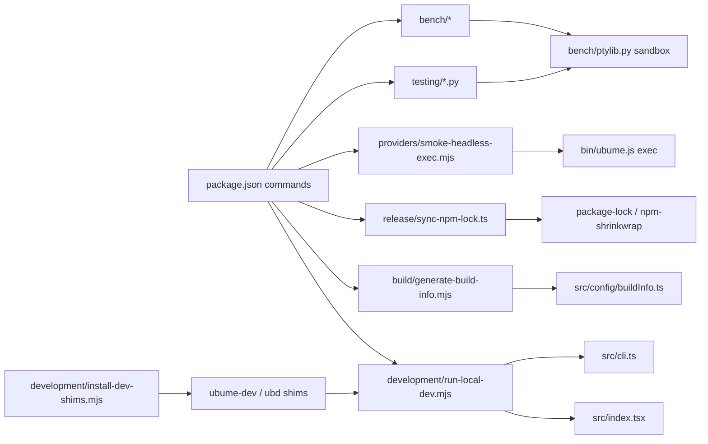

# Scripts guide

`scripts/` holds the standalone utilities around Ubume: the local development launcher, build
metadata, release tooling, provider diagnostics, opt-in terminal checks, maintenance tools and
offline benchmarks. None of it ships: `package.json` `files` publishes only `bin/`, `src/` and
the shrinkwrap. The application code lives in `src/`, and the installed launcher in `bin/`.

Node scripts are ESM (`.mjs`) or TypeScript run by Bun. Terminal checks are Python 3 because they
drive real pseudo-terminals. Tests sit next to the script they cover and run in `bun test`.

## Layout

| Directory | Responsibility | Contents |
|---|---|---|
| `development/` | Running this checkout locally | `run-local-dev.mjs` (`ubume-dev`/`ubd`, `bun run dev:run`), `install-dev-shims.mjs` |
| `build/` | Build metadata | `generate-build-info.mjs` |
| `release/` | npm release path and artifact checks | `sync-npm-lock.ts`, `verify-packaged-harness.ts` |
| `providers/` | Provider diagnostics, setup and live smokes | `smoke-headless-exec.mjs`, `smoke-codexa-native.ts`, `configure-codexa-native.mjs`, `debug-claude-model-discovery.ts` |
| `testing/` | Opt-in end-to-end, PTY and browser checks | `check-terminal-pty.py`, `check-resume-pty.py`, `check-offline-workflow.py`, `check-kitty-responsive.py`, `smoke-workbench.py`, `smoke-local-browser.ts`, `fixtures/` |
| `maintenance/` | Repository upkeep | `audit-capabilities.mjs`, `record-resume-picker.tsx` |
| `bench/` | Offline benchmarks and the shared Python PTY harness | see [Offline benchmarks](#offline-benchmarks-scriptsbench) |
| `lib/` | Helpers shared by several Node scripts | `repo-root.mjs` (`REPO_ROOT`, `repoPath`), `child-process.mjs` (`forwardChildExit`, `exitOnSpawnError`) |

Files at the top level:

- `README.md`: a short pointer to this guide.
- `tsconfig.json`: the file list for `bun run typecheck:utilities`.
- `run-local-dev.mjs` and `pty-terminal-check.py`: compatibility entry points (see below).
- `check-resize-pty.py` and `check-permission-pty.py`: resize and permission PTY checks that are
  still being developed. They move to `testing/` in the next bench pass.



There is no CI workflow in the repository. Validation runs locally (see
[Testing](testing.md)) and through `prepublishOnly` before an npm release.

## Compatibility entry points

| Path | Why it exists | Remove when |
|---|---|---|
| `scripts/run-local-dev.mjs` | `ubume-dev`/`ubd` shims installed before the reorganization exec this absolute path. It imports `development/run-local-dev.mjs` and calls `main()`. | Never needed after everyone reruns `bun run install:dev-bin`; kept because shims live outside the repository. |
| `scripts/pty-terminal-check.py` | `bench/resize.py` and `check-permission-pty.py` load this path for `Screen`. It re-exports `testing/check-terminal-pty.py` and runs it when executed. | The bench pass updates those two scripts. |

Neither file holds logic of its own.

## Safety classes

Check a script's class before running it. Offline scripts use temporary homes and data roots and
a provider-free `PATH`; that isolation is not a network sandbox.

| Class | Meaning | Scripts |
|---|---|---|
| Offline | No provider, account or external request; may write generated project files. | `maintenance/audit-capabilities.mjs`, `build/generate-build-info.mjs`, `maintenance/record-resume-picker.tsx`, `testing/check-terminal-pty.py`, `testing/check-resume-pty.py`, `testing/check-offline-workflow.py`, `bench/*` |
| Local environment | Reads local tools or user settings, or writes outside the repository. | `development/run-local-dev.mjs` (launches the app), `development/install-dev-shims.mjs` (writes shims), `providers/debug-claude-model-discovery.ts` (reads the Claude install), `providers/configure-codexa-native.mjs` (reads a model inventory; refuses overwrites), `testing/smoke-workbench.py` (deterministic fixture provider), `testing/smoke-local-browser.ts` (needs Chromium), `testing/check-kitty-responsive.py` (needs Kitty and a display) |
| Runs a local model | Loads model checkpoints in-process. | `providers/smoke-codexa-native.ts` (local PyTorch; 10-minute deadline) |
| Real provider | Sends real prompts, uses quota, exposes the workspace to an agent. | `providers/smoke-headless-exec.mjs`; `run-local-dev.mjs` with a configured provider; anything run with `--headless-benchmark` |
| Release | Part of `prepublishOnly`. | `release/sync-npm-lock.ts`, `build/generate-build-info.mjs` |
| Installed artifact | Runs against an installed tarball, not the checkout. | `release/verify-packaged-harness.ts` |

Never add real-provider commands to `bun test`. A name containing "smoke" or "bench" says
nothing about safety; read the script's header.

## Command reference

| Package command | Script | Notes |
|---|---|---|
| `bun run dev:run [-- args]` | `development/run-local-dev.mjs` | Same as `ubume-dev`. |
| `bun run install:dev-bin` | `development/install-dev-shims.mjs` | Writes `ubume-dev` and `ubd`. |
| `bun run gen-build-info` | `build/generate-build-info.mjs` | Rewrites tracked `src/config/buildInfo.ts`. |
| `npm run sync:npm-lock` | `release/sync-npm-lock.ts` | Rewrites `package-lock.json` and `npm-shrinkwrap.json`. |
| `bun run typecheck:utilities` | `scripts/tsconfig.json` | Type-checks the TypeScript utilities listed there. |
| `bun run audit:ubume-gap` | `maintenance/audit-capabilities.mjs` | Exit 1 when a capability check fails. |
| `bun run debug:claude-models` | `providers/debug-claude-model-discovery.ts` | JSON report on stdout. |
| `bun run smoke:terminal-bench` | `providers/smoke-headless-exec.mjs` | **Real provider.** |
| `bun run check:pty` | `testing/check-terminal-pty.py` | Opt-in real-PTY regression check. |
| `bun run check:resume` | `testing/check-resume-pty.py` | Deterministic `/resume` PTY regression. |
| `bun run check:e2e` | `testing/check-offline-workflow.py` | Offline end-to-end workflow with fake `codex`/`claude`. |
| `bun run check:resize` | `check-resize-pty.py` | Resize matrix (still at the top level). |
| `bun run bench:*` | `bench/*` | See [Offline benchmarks](#offline-benchmarks-scriptsbench). |

Commands without a package alias:

```bash
node scripts/providers/configure-codexa-native.mjs [--model-root PATH] [--inventory PATH]
bun scripts/providers/smoke-codexa-native.ts <fresh-output-directory>
bun scripts/release/verify-packaged-harness.ts <installed-package-root>
python3 scripts/testing/smoke-workbench.py [recording.cast] [width]
UBUME_BROWSER_MODE=headless bun scripts/testing/smoke-local-browser.ts
python3 scripts/testing/check-kitty-responsive.py --monitor OUTPUT [--style simple|minimal|normal] [--rendering auto|solid]
bun scripts/maintenance/record-resume-picker.tsx
```

## Entry points in detail

### `development/run-local-dev.mjs`

The local counterpart of the installed `bin/ubume.js` launcher. It runs the sources of the
checkout it lives in, whatever the caller's directory.

- **Routing.** It sends interactive launches to `src/index.tsx`. `exec`, `--headless-benchmark`,
  `doctor`, `status`, `config`, `providers`, `models` and `sessions` (also after a leading
  `--json`) go to `src/cli.ts`, as with the installed launcher. A test runs both launchers
  against a fake Bun to keep the routing identical.
- **Child process.** It spawns Bun with inherited stdio, and the caller's directory becomes the
  workspace. It sets `UBUME_CHANNEL=local-dev`, `UBUME_PACKAGE_ROOT` and the relaunch variables.
- **Local handling.** `--help` and `--version` are answered without starting Ink.
- **Model chats.** `native` and `numpy` start the local Codexa chat scripts instead of Ubume.
  Override their locations with `CODEXA_NATIVE_MODEL_ROOT`, `CODEXA_NATIVE_PYTHON`,
  `CODEXA_NATIVE_CHECKPOINT`, `CODEXA_NATIVE_TOKENIZER`, `CODEXA_NATIVE_DEVICE` and the matching
  `CODEXA_NUMPY_*` variables. Missing files are listed and the launcher exits 1.
- **Environment.** `UBUME_BUN_EXECUTABLE` overrides Bun. `UBUME_DEBUG_LAUNCH=1` prints the chosen
  entry.
- **Exit status.** It forwards the child's exit code. A fatal signal is re-raised. Exit 1 when
  the child cannot start.

Two launcher features remain installed-only: `--cwd <dir>` for interactive runs (headless `exec`
parses `--cwd` itself) and `ubume browser install`.

```bash
bun run dev:run -- exec "print the current directory"
ubd doctor --json
ubume-dev --version
```

### `development/install-dev-shims.mjs`

Writes `ubume-dev` and `ubd`. They are shell shims with mode 0755, or `.cmd` files on Windows,
and they exec `development/run-local-dev.mjs` with the path quoted, so a checkout path with
spaces works.

- **Bin directory.** `UBUME_DEV_BIN_DIR`, else the global npm prefix's `bin`, else
  `~/.local/bin`.
- **Rerunning** replaces only those two files; the published `ubume` is never touched.

### `build/generate-build-info.mjs`

Writes `src/config/buildInfo.ts` with `BUILD_COMMIT` (from `git rev-parse HEAD` in the
repository, or `unknown` outside Git) and `APP_VERSION` (from `package.json`). It exits 1
without writing when `package.json` has no version. The file is tracked, so expect a diff after
`bun run build`; never edit it by hand.

### `release/sync-npm-lock.ts`

Derives `package-lock.json` and `npm-shrinkwrap.json` from `bun.lock`, the graph the package is
tested under. It always reads and writes in the repository root. See the
[release guide](../releasing/release-guide.md).

### `maintenance/audit-capabilities.mjs`

A read-only static audit of 17 capabilities. Each check verifies that expected files exist and
that the implementation evidence matches. Exit 0 when all pass, 1 otherwise. When source files
move, update the evidence paths and `audit-capabilities.test.ts` together. A failure means
"investigate", not "the feature is gone".

### `providers/smoke-headless-exec.mjs`

Runs `node bin/ubume.js exec "Print the current directory, list files, and stop."` in the
current directory with your real configuration. This is the path Terminal-Bench uses. It returns
the launcher's exit code, and exit 1 if the launcher is killed by a signal or cannot start. It
contacts the configured provider.

### `testing/` checks

All Python checks build their sandbox with `bench/ptylib.py`, or with the helpers in
`bench/interactive-startup.py`. That means a temporary home and data root, a `PATH` without
`codex`, `claude`, `gemini`, `agy`, `antigravity` or `vibe`, and fake provider executables. Each
prints PASS/FAIL lines and exits non-zero on any failure.

- **`check-offline-workflow.py`.** Pickers, streaming, save and `--resume`, provider switch,
  model recovery, cancellation and `/exit`, and it verifies that only the fakes were spawned.
- **`check-terminal-pty.py`.** Unicode and paste input, resize, the alternate-screen overlay,
  Ctrl+C, terminal restoration, and the compact header across resizes.
- **`smoke-workbench.py`.** Records the real App driven by `fixtures/workbench-app.tsx` into a
  cast. The default destination is the tracked `docs/terminal/recordings/terminal-workbench.cast`;
  pass a path to write elsewhere.

## Offline benchmarks (`scripts/bench/`)

Every suite is offline by construction:

- Each run uses a temporary `HOME` and data root built with `src/test/environment.ts`, so no user
  configuration, credentials or sessions are read or written.
- `PATH` holds only `node` and `bun` plus `/usr/bin:/bin`. A suite refuses to start if a real
  provider CLI is resolvable.
- Subprocess cases use `bench/fakeProducer.mjs`. HTTP goes only to loopback servers, and the
  update check goes to a local proxy that never answers, or is disabled.

| Command | Script | Measures |
|---|---|---|
| `bench:startup` | `bench/startup.ts` | Fresh-process startup timings and module-import attribution. |
| `bench:interactive` | `bench/interactive-startup.py` | PTY first byte, composer visible, input-ready, idle PSS. |
| `bench:startup-timeline` | `bench/startup-timeline.py` | Per-stage startup timeline via `UBUME_STARTUP_TRACE`. |
| `bench:update-startup` | `bench/update-startup.py` | Update-check scenarios against a loopback npm mock. |
| `bench:memory` | `bench/idle-memory.py` | Per-process RSS/PSS and JSC heap reports. |
| `bench:stream` | `bench/stream.ts [--large]` | Subprocess streaming memory, split UTF-8, latency, slow consumers. |
| `bench:stream-e2e` | `bench/stream-e2e.py` | Stream-to-screen latency and ordering through a real PTY. |
| `bench:resize` | `bench/resize.py` | PTY resize geometry, phase timing and history validation. |
| `bench:shell` | `bench/shell-output.ts` | `!shell` output through the real App. |
| `bench:provider-switch` | `bench/provider-switch.ts` | Provider-switch memory, cleanup and latency. |
| `bench:workspace` | `bench/workspace.ts [--large]` | Workspace tracking, checkpoints and saves on synthetic repositories. |
| `bench:render` | `bench/render.ts` | Repeats `bench/markdown-render-probe.ts` in fresh processes. |
| `bench:resume` | `bench/resume.ts` | Session metadata loading and conversation hydration. |
| `bench:all` | `bench/all.ts [--out DIR]` | Every suite; writes `<suite>.json` (default `docs/_reports/performance/bench-results/`). |
| `bench:compare` | `bench/compare.ts BEFORE AFTER` | Improved / regressed / inconclusive per metric. |

- **Results.** Each suite writes JSON (`suite`, `environment`, `method`, `metrics[]` with
  p50/p95/p99/min/max/stddev/CV) and prints a table. `bench:compare` only reports a change when
  the medians differ by more than 5% and by more than the observed spread. It never fails a run.
- **Workspace roots.** These live under `docs/_reports/performance/bench-results/tmp`, on the
  repository's disk, because `/tmp` is often tmpfs.
- **Reports.** Baselines and comparisons are local reports (Git-ignored; see
  [REPORTING.md](../REPORTING.md)).
- **Validator tests.** Run them with
  `python3 -m unittest discover -s scripts/bench -p '*_test.py'`.

## Adding or changing a script

1. **Pick the directory** by primary responsibility. If nothing fits, discuss it before adding
   a new top-level directory. Don't add files to the `scripts/` root.
2. **Name it** in kebab-case, starting with an action: `check-…`, `smoke-…`, `verify-…`,
   `generate-…`, `debug-…`, `record-…`. Skip prefixes the directory already implies.
   - Python modules imported by other scripts are the exception: they need importable names
     (`ptylib.py`).
3. **Start with a header** that gives the purpose, safety class, usage, side effects and exit
   status.
4. **Resolve repository files** with `REPO_ROOT`/`repoPath` from `lib/repo-root.mjs` (Bun
   TypeScript: `join(import.meta.dir, "..", "..")`). Use `process.cwd()` only when the caller's
   workspace is the intent.
5. **Spawn with argument arrays**, never shell strings. Launchers forward the child's exit code
   and signals (`lib/child-process.mjs`). Fail with a non-zero exit and a message on stderr; never
   swallow an error to keep going.
6. **Keep logic testable.** Export pure functions and launch only when executed directly,
   comparing real paths as `run-local-dev.mjs` does. Add a colocated test for routing, path
   resolution or output that others depend on.
7. **Wire it in.** Add a package alias if people run it often. Add TypeScript utilities to
   `scripts/tsconfig.json`. List the script in this guide.

## Pending bench pass

These were deferred while other work was in progress in `scripts/bench/`:

- Rename `bench/fakeProducer.mjs` to kebab-case and give `bench/lib.ts` a descriptive name.
- Move `check-resize-pty.py` and `check-permission-pty.py` into `testing/`, then delete the
  `pty-terminal-check.py` compatibility module.
- Move the shared `Screen` emulator and sandbox helpers out of entry scripts
  (`testing/check-terminal-pty.py`, `bench/interactive-startup.py`) into importable modules
  beside `ptylib.py`.
- Replace dated output directories hard-coded in the resize scripts with `--out` arguments.
